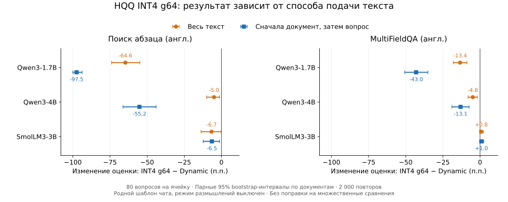
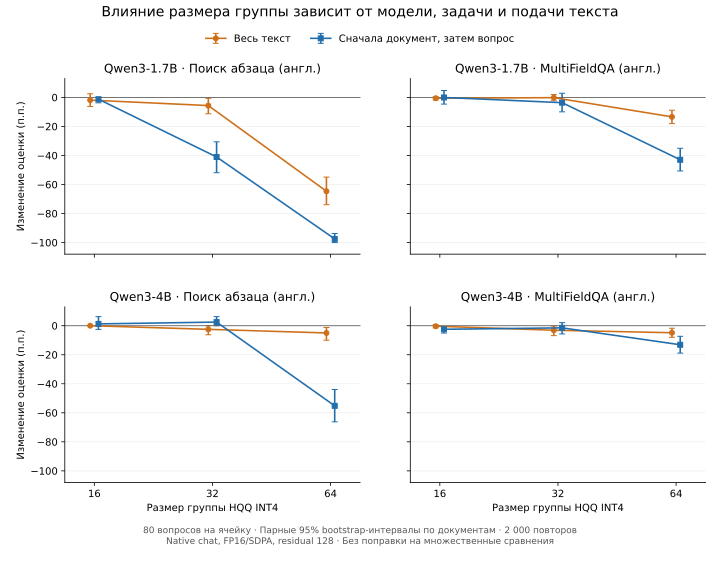
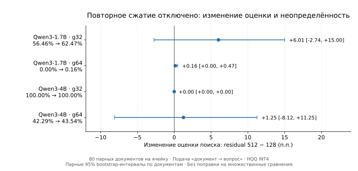
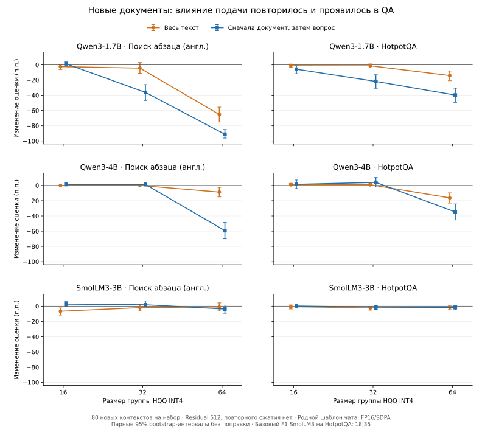
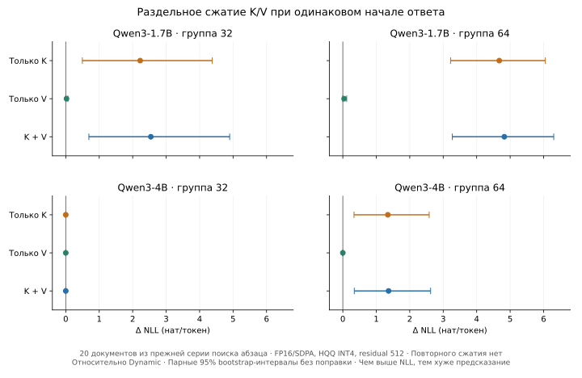
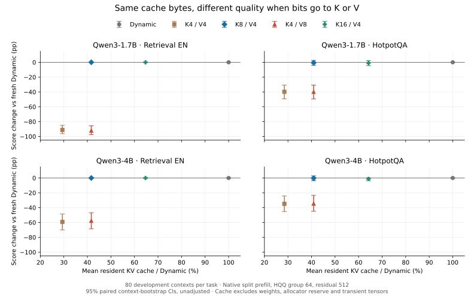

# Как я проверял сжатие памяти языковой модели

Я продолжил здесь своё исследование [синтетического поиска по длинному тексту](https://github.com/chion596/kv-cache-efficiency). На LongBench я хотел понять, можно ли уменьшить память модели и при этом сохранить качество ответов.

Модель хранит в KV-cache информацию о прочитанном тексте. Я сжимал эту память с помощью HQQ и сравнивал ответы с обычным, несжатым кэшем. По ходу работы я проверял размер блока сжатия, разные модели, порядок подачи текста и точность отдельных частей кэша.

## Как развивалось исследование

### Большие блоки сжатия портят ответы?

В первых проверках на LongBench я увидел, что небольшие блоки часто сохраняют качество, а большие могут заметно его снизить. Я проверил, не объясняется ли это слишком длинными ответами: сократил лимит генерации и повторил опыт на новых примерах. Короткий ответ помог лишь частично. Значит, проблема была не только в продолжении ответа.

### Зависит ли результат от модели и способа подачи текста?

Я добавил другие модели и задачи, а также сравнил два режима: весь текст сразу и документ перед вопросом. Результат менялся от модели к модели. У некоторых Qwen большой блок особенно вредил, когда модель сначала читала документ, а потом отвечала на вопрос. Поэтому я не стал считать один размер блока безопасным для всех.

Затем я проверил промежуточный размер блока. Он не стал универсальным решением: в одних условиях качество оставалось высоким, в других падало. Влияние сжатия зависело и от модели, и от задачи.

### Объясняется ли потеря повторным сжатием?

Я увеличил часть кэша, которая хранится без сжатия, и проверил, что повторного сжатия нет. Большая потеря качества всё равно сохранилась. Значит, повторное сжатие не было единственной причиной.

### Повторяется ли эффект на новых текстах?

Я проверил новые документы и добавил задачу с обычными вопросами и ответами. Проблема с большими блоками снова проявилась, особенно у Qwen в режиме «документ, затем вопрос». Это снизило вероятность того, что результат был случайностью на прежних примерах.

### Какая часть кэша чувствительнее: K или V?

Я отдельно проверил ключи K и значения V. В этой проверке сжатие K сильнее ухудшало предсказание нужного ответа. Это навело меня на идею хранить K точнее, а V сжимать сильнее.

### Помогает ли разная точность при одинаковой памяти?

Я сравнил K8/V4 и K4/V8 — варианты с одинаковым измеренным объёмом кэша. В английской серии K8/V4 лучше сохранял качество и занимал около 41% памяти обычного кэша. Это перспективный вариант, но я не считаю его универсальным: ответы не всегда совпадают с ответами без сжатия, а ускорения генерации эксперимент не показал.

### Сохраняется ли результат на китайских текстах?

Для новой проверки я выбрал 120 новых документов на китайском. Один длинный вопрос потребовал увеличить точную часть кэша. Технический запуск на нескольких специально выбранных примерах прошёл успешно, но он не показывает качество на всей выборке. Полный запуск ещё впереди. Английские и китайские тексты различаются и самими документами, и настройкой кэша, поэтому по ним нельзя отдельно измерить влияние языка.

## Что я понял

Сильное сжатие может ухудшить ответ, и размер блока сам по себе не предсказывает результат. В моих проверках важны модель, задача и порядок подачи текста. В отдельной пробе ключи K оказались чувствительнее значений V, а K8/V4 — хорошим компромиссом между качеством и объёмом кэша на проверенных английских данных.

Я пока не проверил, переносится ли этот результат на полную китайскую выборку, работает ли он на других семействах моделей и ускоряет ли генерацию. Поэтому эти вопросы остаются следующими шагами, а не выводами из уже полученных результатов.

## Материалы с подробностями

- [Полная история экспериментов](docs/история_экспериментов_и_аудит_2026-11-21.txt)
- [Новые документы и задачи](docs/expansion_results_2026-11-12.md)
- [Проверка K и V](docs/kv_probe_results_2026-11-15.md)
- [Смешанная точность](docs/mixed_precision_results_2026-11-17.md)
- [Китайская серия: протокол](docs/zh_confirmation_protocol_2026-11-18.md) и [результаты технического запуска](docs/zh_confirmation_smoke_2026-11-21.md)

Данные и вычисления хранятся на кластере ВШЭ. В репозитории находятся код экспериментов, их условия, сводные результаты и графики.
