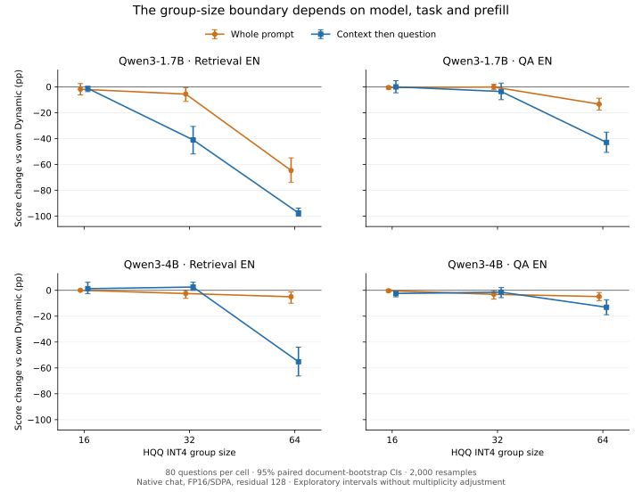

# Квантизация KV Cache на LongBench

Продолжение [исследования на синтетическом passkey retrieval](https://github.com/chion596/kv-cache-efficiency).
Изучаем качество, память и чувствительность HQQ QuantizedCache к размеру группы,
модели и протоколу генерации. Эксперименты выполняются на V100 кластера ВШЭ.

**10 ноября: серия g32 завершена — 8 ячеек, 640 новых ответов.**
В split retrieval Qwen3-1.7B получает 56.46% против 96.25% на g16,
а Qwen3-4B — 100% против 42.29% на g64. Граница чувствительности
зависит от модели, задачи и способа подачи входа.

[Полные результаты g32](docs/group_size_results_2026-11-10.md)
· [Агрегаты и интервалы g32](reports/group_size_v1_2026-11-10/)
· [Условия серии](docs/group_size_control_2026-11-08.md).



Диагностика завершена: у Qwen3-1.7B split retrieval правильный первый номер
есть в 49/80 ответах g32 против 78/80 у Dynamic: −36.25 п.п.,
CI [−47.50; −26.25]. Провал сохраняется по этой вспомогательной метрике.
[Разбор формата и первого токена](docs/group_size_diagnostics_2026-11-10.md).

Следующий шаг на кластере — smoke контроля residual=512:

```bash
bash tools/start_residual.sh smoke
```

Сначала 12 ответов; после проверки — 320 новых полных ответов.
Две Qwen × g32/g64 × split retrieval. Проверяем отсутствие refresh
и совпадение первого токена с residual=128.
[Условия, проверки и команды](docs/residual_control_2026-11-10.md).

**Основная серия protocol_v1 завершена — 36 ячеек, 2 880 ответов.**
У Qwen3-4B потеря retrieval_score при g64 меняется с −5.00 п.п. при подаче
всего входа сразу до −55.21 п.п. при подаче документа перед вопросом.
Дополнительная потеря split: −50.21 п.п., парный CI [−61.88; −38.33].
У SmolLM3 такого большого взаимодействия с порядком prefill не наблюдается.

[Полные результаты и дальнейшие проверки](docs/protocol_v1_full_results_2026-11-08.md)
· [Агрегаты и интервалы CSV](reports/protocol_v1_2026-11-08/)
· [Исходный разбор](docs/review_2026-11-03.md)
· [Зафиксированная матрица](experiments/protocol_v1.json).

CPU-диагностика завершена: 474/480 Dynamic-пар совпали по выходным токенам.
У Qwen3-1.7B split QA g64 первый токен меняется в 70/80 ответах, а refresh
случился только в 1/80. Повторная квантизация не является необходимым условием
провала. [Диагностика и прямые сравнения моделей](docs/protocol_v1_diagnostics_2026-11-08.md).

G32 дополнил эту матрицу на тех же входах двух Qwen.
У Qwen3-4B split retrieval 17/80 первых токенов изменились, при этом все
ответы получили полный балл. Изменение первого токена не является ошибкой ответа.

## Ранние результаты: raw prompts

На 80 вопросах каждого из трёх поднаборов LongBench у Qwen3-1.7B
наблюдается резкое падение между INT4 g32 и g64. Эта тенденция повторяет
первый пилот на других 40 вопросах и прежнюю синтетическую постановку.
У SmolLM3-3B сильное падение в английском retrieval не воспроизвелось.

| Cache | Qwen3-1.7B retrieval EN | SmolLM3-3B retrieval EN | Qwen3-1.7B QA EN | SmolLM3-3B QA EN | Qwen3-1.7B QA ZH |
|---|---:|---:|---:|---:|---:|
| Dynamic | 80.625 | 93.750 | 24.622 | 40.087 | 20.893 |
| INT4 g16 | 78.271 | 93.750 | 24.732 | 39.823 | 21.337 |
| INT4 g32 | 79.271 | 92.500 | 22.752 | — | 18.981 |
| INT4 g64 | 39.512 | 93.125 | 11.677 | 37.710 | 7.759 |
| INT4 g128 | 23.853 | 92.500 | 8.388 | — | 4.824 |

Числа — проценты официальной метрики соответствующего набора, n=80;
retrieval и QA F1 не объединяются в общий результат LongBench.
Прежние серии используют raw prompts без chat template.
Это подвыборки benchmark, не результат полного официального leaderboard.

- [Qwen3: группы, интервалы, peak GPU memory](docs/group_ablation_results_80.md).
- [SmolLM3: retrieval и диагностика первого числа](docs/smollm3_retrieval80_results.md).
- [SmolLM3: QA и влияние продолжений](docs/smollm3_qa80_results.md).
- [Qwen3-4B: протокол прежнего raw-контроля](docs/qwen3_4b_size_control.md).
- [Первый пилот n40](docs/pilot_results_2026-10-22.md), [проверка на новых вопросах n80](docs/heldout_80_results.md),
  [контроль длины ответа](docs/retrieval_length_control.md).

CI SmolLM3 QA g64−Dynamic: −2.376 п.п. [−6.324; +0.885];
это не доказательство эквивалентности. Сравнение моделей включает размер,
обучение, tokenizer и поведение генерации, поэтому причинный эффект архитектуры не установлен.

## Завершённая серия protocol_v1

`protocol_v1`: Qwen3-1.7B / Qwen3-4B / SmolLM3-3B × retrieval EN / QA EN ×
Dynamic / g16 / g64 × два порядка prefill. Всего 36 ячеек и 2 880 основных генераций.

В обеих постановках используются native chat, явно отключённый thinking,
одинаковые token IDs внутри модели, FP16/SDPA и прежние пределы ответа.
В одном случае весь вход подаётся сразу; в другом документ сначала
попадает в cache, а затем подаётся вопрос. Это позволяет проверить,
меняет ли чтение квантованного cache уже при обработке вопроса наблюдаемый эффект.

Проверочный этап дал 108 smoke-ответов и прошёл 18 сверок с `model.generate`.
Полная матрица из 2 880 ответов прошла проверку входов и условий; QA включает
67 документов на 80 вопросов. Полные Dynamic-ответы между порядками prefill
не всегда совпадают; этот эффект разбирается отдельно.
[Инструкция воспроизведения](docs/next_experiments_2026-11-03.md).

Подготовлен контроль residual refresh в retrieval. Далее — ошибки K/V
и независимые новые документы. Приоритеты и объёмы описаны в
[протоколе residual_v1](docs/residual_control_2026-11-10.md).

## Независимость данных и воспроизводимость

Непересекающиеся вопросы QA могут использовать одинаковые документы.
На проверенном официальном архиве 14 из 80 английских и 11 из 80 китайских
новых вопросов относятся к context из первого пилота. Для привязки к кластеру
нужно сверить SHA-256 архива. [Расчёт, revision и индексы](docs/data_independence_audit_2026-11-03.json).
Новая серия сохраняет context hashes и считает парные интервалы по документам.

Сырые результаты остаются на кластере. [Агрегаты protocol_v1](reports/protocol_v1_2026-11-08/)
и [group_size_v1](reports/group_size_v1_2026-11-10/)
включены в Git по предоставленному выводу; интервалы нельзя заново пересчитать
без соответствующих JSONL. Происхождение и контрольные суммы сохранены рядом.
Подготовленные данные, ответы, модели и локальные настройки в Git не добавляются.
Артефакты экспериментов необходимо резервировать вне временного scratch.

```bash
python -m unittest discover -s tests -v
```

Численные тесты дополнительно используют torch/Transformers: проверяют
ручной decode и split prefill на маленьких случайно инициализированных
Qwen3/SmolLM3, без загрузки весов. Тесты подготовки/анализа работают без этих пакетов.
Реальный FP16/HQQ/CUDA-путь прошёл smoke и полную серию на кластере.

Для нового окружения и исходного пилота: [cluster_first_run.md](docs/cluster_first_run.md).
Новая постановка не требует обновления рабочего conda-окружения.

Коммиты описываем кратко, понятно и по-русски; правила — в [AGENTS.md](AGENTS.md).
