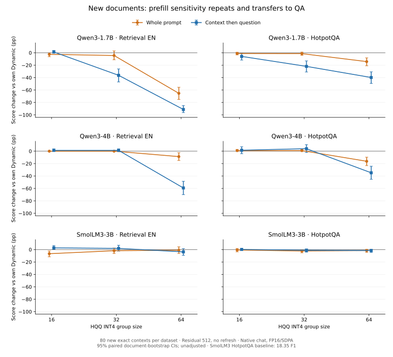

**Полные результаты expansion_v1, 12 ноября 2026 года.**

Получены **48 ячеек и 3 840 ответов**: три модели, два набора, два prefill,
Dynamic/g16/g32/g64, 80 новых exact context на набор. Основной результат:
чувствительность Qwen к чтению приближённого cache воспроизводится на новых
retrieval-документах и переносится на HotpotQA. Она сохраняется при подавленном
refresh и на общей подвыборке HotpotQA без обрезания.

Это результат о проверенных конфигурациях stock HQQ, а не причинный эффект
семейства или общий leaderboard LongBench. Низкий baseline SmolLM3 на HotpotQA
ограничивает выводы о его относительной устойчивости.

[Протокол и выборка](expansion_protocol_2026-11-11.md)
· [Оценки CSV](../reports/expansion_v1_full_2026-11-12/dataset_scores.csv)
· [78 основных контрастов](../reports/expansion_v1_full_2026-11-12/paired_contrasts.csv)
· [39 контрастов без обрезания](../reports/expansion_v1_full_2026-11-12/untruncated_contrasts.csv)
· [Происхождение данных](../reports/expansion_v1_full_2026-11-12/provenance.json).

Дополнение 14 ноября: [CPU-диагностика завершена](expansion_diagnostics_2026-11-14.md).
Получены реальные Dynamic/g64 split means subset56, проверены первая строка QA
и первый номер retrieval. Подготовлен [отдельный K/V-контроль](kv_probe_protocol_2026-11-14.md);
на кластере он пока не запускался.

Источник — предоставленный stdout полного scoring и отдельно присланный CSV
общей подвыборки. Проверены 48 уникальных средних, арифметическая согласованность
78 основных контрастов, шести Dynamic drift и внутренние соотношения 39 subset
контрастов. CI скопированы из кластерных CSV; они не восстановлены из средних.
Raw JSONL, полный audit JSON и Slurm/hardware logs локально отсутствуют.
Subset means не входили в экспорт 12 ноября; шесть из 24 средних получены
в отдельной диагностике 14 ноября и сохранены с собственным provenance.
Экспорт начинается после заголовка проверки матрицы; проверки отсутствия refresh
и provenance заложены в завершившийся scorer, но независимо здесь не повторялись.

**Условия.** Native chat с thinking=False, FP16/SDPA, HQQ INT4, axis_key=axis_value=1,
residual=512. Вход до 16 384 токенов, ответ до 32 токенов. Внутри модели
сравниваются одинаковые полные input IDs; split подаёт документ перед вопросом.
Вопросы зафиксированы до генерации и исключены из сохранённой истории n40/n80.
Exact hashes не исключают смысловые/частичные дубли и pretraining contamination.



**Retrieval EN, официальный retrieval_score, %.**

| Модель | Prefill | Dynamic | g16 | g32 | g64 |
|---|---|---:|---:|---:|---:|
| Qwen3-1.7B | весь вход | 91.25 | 88.75 | 86.88 | 25.97 |
| Qwen3-1.7B | документ → вопрос | 92.50 | 93.75 | 56.22 | 1.25 |
| Qwen3-4B | весь вход | 97.50 | 97.50 | 97.50 | 88.75 |
| Qwen3-4B | документ → вопрос | 97.50 | 98.75 | 98.75 | 38.25 |
| SmolLM3-3B | весь вход | 84.58 | 77.92 | 82.71 | 83.54 |
| SmolLM3-3B | документ → вопрос | 84.58 | 87.29 | 86.46 | 80.83 |

**HotpotQA, официальный QA F1, %.**

| Модель | Prefill | Dynamic | g16 | g32 | g64 |
|---|---|---:|---:|---:|---:|
| Qwen3-1.7B | весь вход | 41.20 | 39.97 | 39.82 | 27.00 |
| Qwen3-1.7B | документ → вопрос | 40.78 | 34.92 | 18.89 | 0.96 |
| Qwen3-4B | весь вход | 58.95 | 59.89 | 59.89 | 42.67 |
| Qwen3-4B | документ → вопрос | 58.95 | 60.48 | 62.94 | 24.12 |
| SmolLM3-3B | весь вход | 18.35 | 17.69 | 16.01 | 16.78 |
| SmolLM3-3B | документ → вопрос | 18.35 | 18.53 | 17.17 | 16.71 |

**Изменения g64 относительно собственного Dynamic и взаимодействие с prefill, п.п.**

| Модель | Набор | Весь вход, 95% CI | Split, 95% CI | Split loss−single loss, 95% CI |
|---|---|---|---|---|
| Qwen3-1.7B | Retrieval | -65.28 [-75.11; -55.53] | -91.25 [-96.25; -85.00] | -25.97 [-35.48; -16.71] |
| Qwen3-1.7B | HotpotQA | -14.20 [-20.94; -8.25] | -39.83 [-49.33; -30.72] | -25.63 [-34.21; -17.75] |
| Qwen3-4B | Retrieval | -8.75 [-15.00; -2.50] | -59.25 [-70.00; -48.50] | -50.50 [-62.87; -39.25] |
| Qwen3-4B | HotpotQA | -16.28 [-23.20; -9.72] | -34.83 [-45.27; -24.23] | -18.55 [-28.10; -8.51] |
| SmolLM3-3B | Retrieval | -1.04 [-6.25; +4.38] | -3.75 [-9.38; +1.46] | -2.71 [-8.75; +3.33] |
| SmolLM3-3B | HotpotQA | -1.57 [-4.51; +0.33] | -1.64 [-4.58; +0.52] | -0.06 [-1.46; +1.45] |


Все интервалы — парный percentile bootstrap по source context, 2 000 повторов,
seed 2026, номинальные 95%, без коррекции множественных сравнений. Средние
retrieval_score и QA F1 не объединяются. Сравнение с Dynamic использует baseline
своего протокола, а не простую разность single/split quant scores.

**Что воспроизвелось и что перенеслось.**

1. **Qwen3-1.7B g32 чувствителен к split уже на двух задачах.** На новых retrieval
   потеря относительно Dynamic −36.28 п.п. [−46.90; −26.04], при single
   −4.38 [−11.25; +2.92]. На HotpotQA split: −21.89 [−30.93; −13.11],
   single: −1.38 [−4.03; +1.13]. Взаимодействие g32−prefill на HotpotQA
   −20.51 [−29.66; −12.03]. Это не только специфическая ошибка retrieval-метрики.
2. **Qwen3-4B g32 на этой выборке близок к собственному baseline, но g64 сильно
   теряет при split.** Retrieval: 97.50% Dynamic, 98.75% g32 и 38.25% g64.
   HotpotQA: 58.95%, 62.94% и 24.12%. Положительное среднее g32−Dynamic
   на HotpotQA +4.00 с CI [−2.10; +10.48] не устанавливает улучшение.
3. **Внутрисемейное различие по размеру зависит от группы.** При split g32
   Qwen3-4B−Qwen3-1.7B по внутримодельным потерям: +37.53 п.п. retrieval
   [27.11; 48.39] и +25.89 HotpotQA [15.83; 36.75]. Но для split g64 HotpotQA
   разность +5.00 [−7.55; 18.16] не выделяется. Размер не гарантирует устойчивость.
4. **У SmolLM3 нет сопоставимого усиления потерь g64 при split.** На retrieval
   взаимодействие −2.71 [−8.75; 3.33], на HotpotQA −0.06 [−1.46; 1.45].
   Прямой контраст потерь SmolLM3−Qwen3-4B в split retrieval:
   +55.50 [42.71; 68.21]. В single retrieval +7.71 [−0.21; 16.04],
   где интервал включает ноль. Перенос различия на все протоколы не установлен.
5. **Group size не задаёт монотонность качества.** У SmolLM3 single retrieval
   g16 теряет 6.67 п.п. [−11.67; −2.29], тогда как g64 −1.04 [−6.25; 4.38].
   У Qwen3-1.7B split HotpotQA даже g16 даёт номинальную потерю
   −5.86 [−11.69; −0.75]. Эти наблюдения требуют учёта формата ответов
   и множественных сравнений; g16 нельзя объявить универсально безвредным.

**Повторение на новых retrieval context при одинаковом r512.**

| Модель/cache, split | Прежние 80: quant−Dynamic, п.п. | Новые 80: quant−Dynamic, п.п. |
|---|---:|---:|
| Qwen3-1.7B g32 | −35.03 | −36.28 |
| Qwen3-1.7B g64 | −97.34 | −91.25 |
| Qwen3-4B g32 | +2.50 | +1.25 |
| Qwen3-4B g64 | −53.96 | −59.25 |

Направление и порядок величин сохраняются на непересекающихся exact context.
Эта таблица описательная: CI разности между сериями по одним средним не вычислялся.
Другие прежние r128-результаты не объединяем с r512 как идентичные условия.

**Общая подвыборка HotpotQA без обрезания: 56 документов.**

| Модель | g64−Dynamic single, п.п. | g64−Dynamic split, п.п. | Взаимодействие, п.п., 95% CI |
|---|---:|---:|---|
| Qwen3-1.7B | −12.76 | −37.79 | −25.04 [−35.88; −14.57] |
| Qwen3-4B | −11.26 | −34.01 | −22.75 [−34.97; −10.61] |
| SmolLM3-3B | −2.03 | −2.40 | −0.37 [−2.04; +1.16] |

Таким образом, усиление потерь Qwen при split сохраняется, когда ни одна
модель не обрезает документ. Прямой контраст SmolLM3−Qwen3-4B для split g64
также сохраняется: **+31.61 п.п. [19.50; 44.39]**. Для g32 различие потерь
Qwen3-4B−Qwen3-1.7B: **+16.18 [5.25; 27.39]**. Разные границы видимого контекста
не объясняют результат целиком. Однако 56 случаев — выбранная по длине
подвыборка; её нельзя объявлять новым случайным независимым тестом.

**Baseline SmolLM3 ограничивает интерпретацию межмодельного QA-сравнения.**

Полный Dynamic HotpotQA F1 — 18.35% у SmolLM3 против 58.95% у Qwen3-4B.
При g64 split абсолютное качество SmolLM3 16.71% всё ещё ниже Qwen3-4B 24.12%,
хотя потеря относительно baseline меньше. Меньшее падение не равно большей
полезности или доказанной архитектурной устойчивости.

До получения subset means ограничение проверили по арифметическим границам. Из F1∈[0,1]
следует: F1 SmolLM3 на любом subset56 не выше **26.21%**, а Qwen3-4B — не ниже
**41.36%**. Это арифметические границы, не CI:
max_subset = min(56, 80×mean)/56; min_subset = max(0, 80×mean−24)/56.
[Границы](../reports/expansion_v1_full_2026-11-12/baseline_subset_bounds.csv).
Дополнение 14 ноября: фактические Dynamic means subset56 — **19.21% SmolLM3
и 62.64% Qwen3-4B**. Усечение до первой строки не улучшило SmolLM3 F1
ни в одной из восьми ячеек. Это не исключает другие ошибки формата;
поэлементные ответы локально по-прежнему отсутствуют.

**Dynamic и стоимость.**

Output IDs Dynamic совпали в **470/480** single/split-парах. Разные первые
токены — в трёх парах. Средний drift: +1.25 п.п. у 1.7B retrieval,
−0.4167 у 1.7B HotpotQA, ноль в остальных ячейках. Это небольшой фон относительно
крупных quant-потерь, который уже вычтен через собственные baselines протоколов.

Scorer вывел 4.58 GPU-часа генерации. Для full n=80 его формула фактически
суммирует записанные prefill/decode durations, несмотря на общий текст
«экстраполяция». Это не полный расход Slurm: нет загрузки весов, GC, логирования
и ожидания. Нормализованное сравнение throughput или resident KV memory отсюда
не следует. Всего текущие четыре полные серии дали 7 680 генераций; это число
вычисленных ответов, а не 7 680 независимых документов.

**CPU-разбор сохранённых ответов завершён 14 ноября, без новых GPU-генераций.**

[Выводы и агрегаты диагностики](expansion_diagnostics_2026-11-14.md).
Для повторения:

```bash
cd ~/kv-cache-longbench-pilot
git pull --ff-only
module load python
conda activate kvcache
python -m src.analyze_expansion
```

Скрипт сохраняет `results/expansion_v1/details/full/`: реальные средние subset56,
число Dynamic-ответов HotpotQA с F1=1/F1=0, диагностический F1 первой строки
и правильность первого номера retrieval. Он не меняет официальный scoring,
сырые результаты или протокол. Диагностика первой строки post-hoc; её рост
не заменяет официальный результат, а отсутствие роста не исключает все ошибки формата.

**Приоритет дальнейших экспериментов.**

1. Зафиксировать эти результаты как основной материал для научрука:
   воспроизведение на новых документах, перенос retrieval→QA и контроль без обрезания.
   После CPU-разбора отдельно сформулировать, что установлено о качестве,
   а что остаётся гипотезой о механизме или семействе.
2. Подготовлен небольшой [механизм-контроль](kv_probe_protocol_2026-11-14.md): две Qwen, g32/g64, заранее выбранные 20
   retrieval-документов, общий teacher-forced префикс номера абзаца, NLL/logit
   margins и K-only/V-only/both/Dynamic. Dynamic можно посчитать один раз:
   2 модели × 7 политик × 20 документов = 280 оценок без свободного decode.
   Runner и проверки селективного cache реализованы и проверены локально;
   далее только Slurm smoke, на кластере новая серия пока не запускалась.
3. Язык — отдельная последующая ось на retrieval EN/ZH. При одинаковых условиях
   две Qwen × 80 новых ZH context × два prefill × четыре cache дают 1 280 новых
   генераций; длины query и метрики ZH надо проверить до фиксации. Сравнение
   разных EN/ZH документов остаётся ассоциацией языка и распределения данных.
4. Для эффективности — отдельные resident-KV и latency измерения при одинаковых
   длинах и политике ответа. Текущие различия продолжений не дают чистого
   сравнения скорости. Расширять одновременно все оси сейчас не требуется.

Для научрука: **«На новых документах и новой QA-задаче повторяется взаимодействие
group size с prefill: у Qwen split заметно усиливает потери HQQ INT4 cache.
Эффект сохраняется без refresh и без обрезания. Межмодельное различие наблюдается,
но его нельзя приписать одной архитектуре, особенно при слабом baseline SmolLM3».**

График воспроизводится: `python tools/plot_expansion_snapshot.py`.
