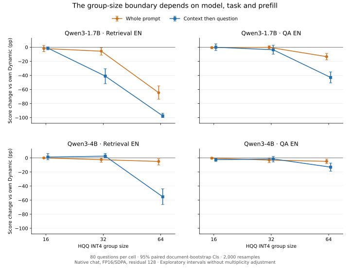

**Полные результаты group_size_v1, 10 ноября 2026 года.**

Серия g32 завершена: **8 ячеек, 640 новых ответов**, n=80 в каждой ячейке.
Сравниваем с сохранёнными Dynamic/g16/g64 из protocol_v1. Это те же вопросы,
native chat без thinking, FP16/SDPA, residual_length=128, HQQ INT4 с обеими
осями 1. Порядок prefill и token IDs сохранены. [Зафиксированные условия](group_size_control_2026-11-08.md).

Главный результат: **граница чувствительности зависит от модели, задачи и
prefill-протокола**. В split retrieval Qwen3-1.7B сильно теряет качество уже
на g32, тогда как Qwen3-4B на g32 получает 100%, а на g64 — 42.29%.
Утверждение «падение всегда начинается между g32 и g64» не переносится
с прежней raw-постановки на все проверенные условия.

Источник — предоставленный терминальный вывод `src.score_group_size --phase full`
и его `paired_contrasts.csv`. На кластере scorer сообщил о пройденной проверке
8 ячеек и 640 ответов. Здесь проверены 8 уникальных агрегатов и арифметическая
согласованность всех 32 точечных контрастов с новыми и опубликованными средними.
CI скопированы из CSV; исходных JSONL в checkout нет. Полный `sacct` и номер
Slurm-массива в экспорт не входили.

[Новые оценки](../reports/group_size_v1_2026-11-10/dataset_scores.csv)
· [Парные контрасты](../reports/group_size_v1_2026-11-10/paired_contrasts.csv)
· [Общая таблица g16/g32/g64](../reports/group_size_v1_2026-11-10/combined_scores.csv)
· [Происхождение и SHA-256](../reports/group_size_v1_2026-11-10/provenance.json).



**Официальные оценки, %.** Retrieval и QA F1 не объединяются.

| Модель | Задача | Prefill | Dynamic | g16 | g32 | g64 |
|---|---|---|---:|---:|---:|---:|
| Qwen3-1.7B | Retrieval | весь вход | 97.50 | 95.62 | 91.88 | 32.85 |
| Qwen3-1.7B | Retrieval | документ → вопрос | 97.50 | 96.25 | 56.46 | 0.00 |
| Qwen3-4B | Retrieval | весь вход | 96.25 | 96.25 | 93.75 | 91.25 |
| Qwen3-4B | Retrieval | документ → вопрос | 97.50 | 98.75 | 100.00 | 42.29 |
| Qwen3-1.7B | QA | весь вход | 45.88 | 45.30 | 45.71 | 32.47 |
| Qwen3-1.7B | QA | документ → вопрос | 45.87 | 45.81 | 42.24 | 2.91 |
| Qwen3-4B | QA | весь вход | 54.28 | 53.93 | 51.16 | 49.44 |
| Qwen3-4B | QA | документ → вопрос | 54.28 | 51.83 | 52.80 | 41.16 |

**Основные парные контрасты g32−Dynamic, п.п.**

| Модель | Задача | Весь вход, 95% CI | Документ → вопрос, 95% CI |
|---|---|---|---|
| Qwen3-1.7B | Retrieval | −5.63 [−11.25; −0.63] | −41.04 [−51.88; −30.63] |
| Qwen3-4B | Retrieval | −2.50 [−6.25; 0.00] | +2.50 [0.00; +6.25] |
| Qwen3-1.7B | QA | −0.17 [−2.33; +1.95] | −3.63 [−9.92; +2.88] |
| Qwen3-4B | QA | −3.11 [−6.84; −0.20] | −1.47 [−5.66; +2.12] |

Интервалы — парный bootstrap исходных документов, 2 000 повторов, seed 2026;
80 документов retrieval, 67 документов QA. Это номинальные 95% интервалы
без коррекции множественных сравнений. Совпадение с нулём на границе CI
не обосновывает улучшение или эквивалентность. Выборка уже использовалась
в разработке и предыдущих сериях; новые 640 генераций не дают 640 независимых задач.

**Что изменилось в выводах.**

1. Qwen3-1.7B split retrieval: g32 проигрывает g16 **39.79 п.п. [−50.42; −29.79]**,
   но выигрывает у g64 **56.46 п.п. [46.04; 66.04]**. Таким образом, g32 —
   промежуточный режим с крупной потерей, а не безопасная замена g16 в этой постановке.
2. Взаимодействие split с потерями g32 retrieval у 1.7B:
   **−35.42 п.п. [−46.25; −24.17]**. У 4B оно равно **+5.00 [1.25; 10.00]**.
   Полная выборка подтверждает различное поведение моделей, замеченное в smoke.
3. Прямое различие внутримодельных потерь g32, Qwen3-4B−Qwen3-1.7B:
   **+43.54 п.п. [32.71; 54.79]** в split retrieval. В single retrieval —
   +3.13 [−3.33; 9.79], где интервал включает ноль. Размер помогает в конкретном
   сравнении, но эффект не универсален по протоколам и задачам.
4. Qwen3-4B split retrieval: g32 выигрывает у g64
   **57.71 п.п. [46.67; 68.13]**. 100% на выбранных 80 вопросах не доказывают
   универсальной безошибочности; +2.50 п.п. к Dynamic с CI [0; 6.25] не являются
   достаточным основанием заявлять, что квантизация улучшает retrieval.
5. Для QA картина мягче. У 1.7B g32 близок к Dynamic по точечной оценке single;
   split допускает и заметную потерю, и небольшое улучшение. У 4B single есть
   номинальная потеря 3.11 п.п., но прямой контраст потерь моделей включает ноль.
   Универсального преимущества размера и монотонного ухудшения по group size
   по этим QA-данным не устанавливаем.

**Изменение первого токена — признак чувствительности, а не критерий ошибки.**

| Модель | Задача | Prefill | Изменён первый токен | Refresh | EOS | Score, % |
|---|---|---|---:|---:|---:|---:|
| Qwen3-1.7B | Retrieval | весь вход | 0/80 | 0/80 | 69/80 | 91.88 |
| Qwen3-1.7B | Retrieval | документ → вопрос | 50/80 | 80/80 | 42/80 | 56.46 |
| Qwen3-4B | Retrieval | весь вход | 0/80 | 0/80 | 78/80 | 93.75 |
| Qwen3-4B | Retrieval | документ → вопрос | 17/80 | 80/80 | 80/80 | 100.00 |
| Qwen3-1.7B | QA | весь вход | 0/80 | 0/80 | 78/80 | 45.71 |
| Qwen3-1.7B | QA | документ → вопрос | 32/80 | 0/80 | 67/80 | 42.24 |
| Qwen3-4B | QA | весь вход | 0/80 | 0/80 | 73/80 | 51.16 |
| Qwen3-4B | QA | документ → вопрос | 10/80 | 0/80 | 74/80 | 52.80 |

У Qwen3-4B split retrieval все 17 ответов с изменённым первым токеном сохраняют
полный официальный балл, поскольку средний score всех 80 равен 100%.
У обоих Qwen split retrieval refresh происходит во всех ответах, но качество
различается на 43.54 п.п. Следовательно, refresh не достаточен для провала,
а изменение первого токена не эквивалентно неправильному ответу.

Для QA refresh нет ни в одном ответе g32; повторно подтверждается, что
изменение генерации возможно без него. [Прежняя диагностика g64](protocol_v1_diagnostics_2026-11-08.md)
уже показывала сильный провал 1.7B QA почти без refresh. Причинный вклад чтения
приближённого контекста, отдельных K/V и слоёв пока не разделён.

**Следующий шаг без GPU.**

Подготовлен разбор сохранённых ответов: сколько изменений первого токена
сопровождается потерей официального балла, сколько ответов остаётся правильным,
как отличаются retrieval_score и правильность первого номера абзаца.
Сохраняются парные диагностические интервалы и траектории g16→g32→g64 по вопросам.

```bash
cd ~/kv-cache-longbench-pilot
git pull --ff-only
module load python
conda activate kvcache
python -m src.analyze_group_size
```

Файлы: `results/group_size_v1/details/full/`. Генерации повторно не выполняются,
официальные метрики и исходные результаты не меняются. Разбиение по изменению
первого токена описательное: это переменная, возникшая после применения
квантизации, и такое разбиение не устанавливает причинность.

**Приоритеты следующих экспериментов.**

1. После диагностики формата — отдельный контроль refresh для retrieval:
   две Qwen × g32/g64 × split × 80 тех же вопросов, residual_length=512,
   **320 новых ответов** плюс собственный smoke. Это превышает известный
   query block до 393 токенов плюс предел ответа 32 и должно исключить refresh;
   фактическое отсутствие проверяется счётчиками. Прямое сравнение с residual=128
   оценит вклад обновления. Повышение residual также меняет долю точных состояний,
   поэтому результат нельзя интерпретировать как чистую ошибку повторного округления.
   Runner для этой новой серии ещё не реализован; менять completed config нельзя.
2. Для механизма первого шага — заранее зафиксированная небольшая выборка
   документов, общий teacher-forced префикс, сравнение NLL/logit margin,
   K-only/V-only и чувствительных слоёв. Не отбирать итоговый test set только
   по самым плохим примерам g32.
3. Масштабирование данных — независимые документы и новый тип задачи.
   Сначала посчитать доступные неиспользованные context и исключить пересечения
   с прошлыми пилотами; не назначать n, превышающий доступный независимый пул.
   Здесь дополнительные GPU-часы дадут проверку переносимости, а не только
   больше повторов на тех же 80 вопросах.
4. Семейство/язык и память/скорость — отдельные оси. Ещё одна модель сравнимого
   размера и языковые наборы полезны после фиксации протокола; различия задач,
   tokenizer и числа токенов нужно учитывать. Текущие quality-таблицы не дают
   resident-KV memory или throughput Pareto-вывода.

Для научрука: **«На LongBench граница допустимого размера группы HQQ INT4 KV-cache
зависит одновременно от модели, задачи и способа подачи входа: у Qwen3-1.7B
split retrieval деградирует уже на g32, у Qwen3-4B выраженный провал возникает
на g64. Изменение первого токена и refresh сами по себе не являются ошибкой
и требуют отделения от итогового качества ответа».**

График воспроизводится из опубликованных агрегатов:

```bash
python tools/plot_group_size_snapshot.py
```

Matplotlib нужен только для рисунка, в отдельном analysis-окружении.
