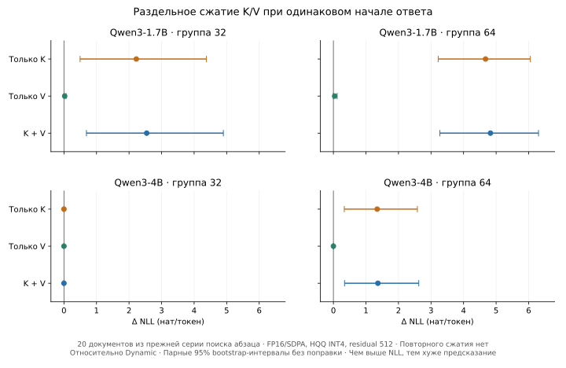

**kv_probe_v1 завершена: 14 ячеек, 280 оценок, 15 ноября 2026 года.**

На 20 ранее изученных retrieval-документах основная потеря условного
предсказания номера локализуется в квантизации **K**. При g64 прямой парный
контраст K-only−V-only положителен у обеих Qwen. У 1.7B различие уже велико
при g32; у 4B g32 меняет NLL очень мало. Это результат селективного
вмешательства в проверенном HQQ-пути, а не общий закон о важности K и V.

[Матрица и условия](kv_probe_protocol_2026-11-14.md)
· [14 средних](../reports/kv_probe_full_2026-11-15/dataset_scores.csv)
· [40 парных контрастов](../reports/kv_probe_full_2026-11-15/paired_contrasts.csv)
· [Происхождение](../reports/kv_probe_full_2026-11-15/provenance.json).

Источник — присланный stdout полного scorer и CSV. Проверены 14 уникальных
ячеек n=20, арифметика всех 40 точечных контрастов, конечность значений,
порядок границ CI и сумма времени. CI скопированы из кластерного вывода;
по средним они не пересчитывались. Raw JSONL, per-document значения,
Slurm-логи и измерения resident cache memory локально отсутствуют.

**Условия.** Две Qwen3, retrieval EN, документ → вопрос, FP16/SDPA,
HQQ INT4, axes=1, residual=512. Один общий forced-префикс
`The abstract is from Paragraph `; оцениваются gold-токены номера,
без пунктуации и EOS. Первые 20 source indices взяты в прежнем зафиксированном
порядке expansion_v1, без отбора по качеству. Это 20 документов, а не
280 независимых наблюдений. Scorer подтвердил отсутствие refresh и
селективные HQQ-вызовы. В шести Dynamic/both-ячейках ноль несовпадений
первого свободного токена с expansion_v1. Точная сверка logits со stock
прошла в [smoke](kv_probe_smoke_2026-11-14.md); в full она повторно не печатается.



**Основная метрика — изменение средней gold-number NLL, nats/token.**

| Модель | Группа | K−Dynamic | V−Dynamic | Both−Dynamic | Прямой K−V, 95% CI |
|---|---:|---:|---:|---:|---|
| Qwen3-1.7B | 32 | +2.2239 | +0.02154 | +2.5425 | **+2.2023 [0.4523; 4.3591]** |
| Qwen3-1.7B | 64 | +4.6750 | +0.03868 | +4.8263 | **+4.6363 [3.1764; 6.0250]** |
| Qwen3-4B | 32 | +0.0000561 | −0.00000111 | +0.0000477 | +0.0000572 [0.0000000030; 0.0001716] |
| Qwen3-4B | 64 | +1.3449 | +0.00000134 | +1.3673 | **+1.3449 [0.3339; 2.5807]** |

Положительная delta означает ухудшение. Все интервалы — парный bootstrap
по 20 source context, 2 000 повторов, seed=2026, номинальные 95%, без
коррекции множественных сравнений. Выделенные крупные различия относятся
к этой exploratory-постановке и выбранным документам.

Абсолютная Dynamic NLL — 0.67924 у 1.7B и 0.00000206 у 4B. При both g64
получаем 5.50552 и 1.36730 соответственно. Отношения NLL к почти нулевому
baseline 4B неинформативны; сравниваем парные разности в исходных единицах.

**Что установлено.**

1. **Крупный g64-эффект остаётся при одинаковом принудительном префиксе.**
   K-only повышает NLL на +4.6750 [3.2202; 6.0527] у 1.7B и
   +1.3449 [0.3339; 2.5807] у 4B. Следовательно, расхождение свободного
   продолжения не объясняет весь ранее наблюдавшийся провал.
2. **На этих документах K-only заметно вреднее V-only.** Это подтверждается
   прямым парным K−V, а не сравнением двух отдельных CI с Dynamic.
   Измерение не устанавливает, какие слои/каналы или статистики ошибки K
   создают эффект: реконструкцию K/V и attention здесь не измеряли.
3. **Разница g32/g64 зависит от модели.** У 1.7B первый gold-токен top1
   верен в 19/20 Dynamic, 15/20 both g32 и 7/20 both g64. У 4B —
   20/20, 20/20 и 15/20. Это первый токен номера, **не точность полного
   номера** и не официальный retrieval_score. При 4B g32 номинальный
   CI K−V выше нуля, но абсолютный эффект около 0.000057 nats/token;
   его нельзя описывать как сопоставимый с провалом g64.

**Что не следует из этих результатов.**

- **V не является безвредным во всех условиях.** У 1.7B g32 V-only даёт
  +0.02154 NLL, CI [0.000000018; 0.06262], и margin −0.25781
  [−0.50938; −0.05313]. Эффекты малы относительно K, но не тождественно нулевые.
- **Both и K-only не признаны эквивалентными.** Доступные NLL-интервалы
  неаддитивности `both−K−V+Dynamic` включают ноль; это не прямой CI both−K
  и не доказательство отсутствия взаимодействия. У 4B g64 неаддитивность
  margin −0.55859 [−0.92500; −0.18984] выделяется номинально. Вывод зависит
  от измеряемой величины; «V ничего не меняет» был бы неверным упрощением.
- **Причинный эффект размера/семейства не установлен.** Селективное
  вмешательство сравнивает K/V внутри каждой модели. Для парного
  межмодельного контраста нужны per-document разности; CI нельзя получить
  вычитанием границ уже присланных интервалов. Здесь только две Qwen.
- **Forced-префикс не является бесплатным исправлением native-генерации.**
  Он меняет условие предсказания и исключает часть ошибок траектории ответа.
  Для полезного исправления надо вернуть свободный decode и официальный score.
- **Небольшой NLL сам по себе не доказывает сохранение всего ответа.**
  Окончание номера, пунктуация/EOS и QA-поведение этой пробой не проверяются.

**Ресурсы.** Полная серия дала 368.81 s основных forward у 1.7B и
647.59 s у 4B, суммарно **0.28233 GPU-часа, около 17 GPU-минут**.
В full формула scorer суммирует наблюдаемые длительности, хотя печатает
«оценка времени». Нет загрузки моделей, GC, логирования вне evaluate и очереди.
Это не расход Slurm и не сравнительный benchmark скорости политик.

**CPU-разбор завершён.** [Результаты диагностики](kv_probe_diagnostics_2026-11-15.md).
Для повторения без новых GPU:

```bash
cd ~/kv-cache-longbench-pilot
git pull --ff-only
module load python
conda activate kvcache
python -m src.analyze_kv_probe
```

Он сохраняет `results/kv_probe_v1/details/full/`: прямой both−K,
g64−g32 и межмодельный контраст K−V, чувствительность к исключению одного
документа и сопоставление с native первым номером на тех же 20 случаях.
Условие `p(gold token)>1/2` для всех токенов — отдельная диагностика;
оно не проверяет завершение номера/EOS. Подвыборка правильных Dynamic
первых токенов зависит от baseline; leave-one-out диапазон не является CI.

Следующий GPU-вопрос — **может ли более точный K вернуть native-качество
при фиксированном объёме cache?**
[План смешанной точности](mixed_precision_plan_2026-11-15.md): K8/V4 против
K4/V8 и K16/V4, с реальными cache bytes и свободной генерацией.
[Smoke пройден](mixed_precision_smoke_2026-11-15.md), полные результаты
mixed_precision_v1 ещё не получены.

Асимметричная обработка K/V уже имеет литературную основу: например,
[KIVI](https://arxiv.org/abs/2402.02750) мотивирует per-channel квантизацию K
и per-token V. Наши stock HQQ axes=1 и границы групп не повторяют этот метод;
это не сравнение с KIVI и не подтверждение его механизма. Самостоятельный
вклад проекта разумно строить вокруг воспроизводимой зависимости
group size × prefill × модель и проверки исправления при измеренном бюджете.

График: `python tools/plot_kv_probe_snapshot.py`.
