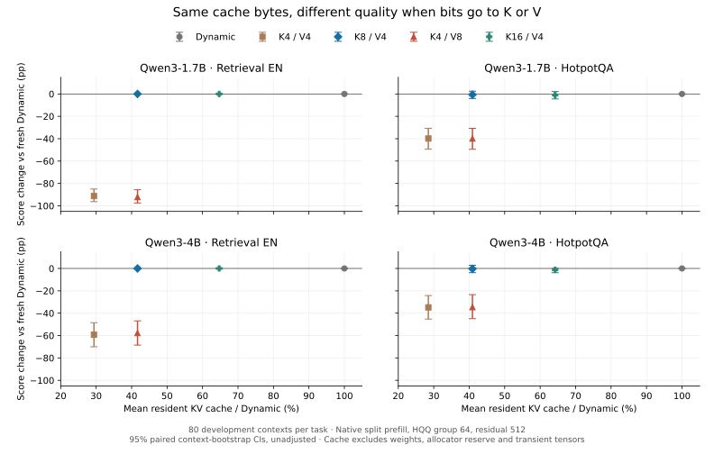

**mixed_precision_v1 завершена: 20 ячеек, 1 600 ответов, 17 ноября 2026 года.**

Я сравнил политики при одинаковом измеренном размере GPU cache: **K8/V4 существенно лучше K4/V8**
на обеих Qwen и обеих задачах. K8/V4 занимает около 41% cache Dynamic;
retrieval score совпал со средним Dynamic, HotpotQA F1 близок к baseline.
На QA интервалы ещё допускают потери до примерно четырёх п.п., поэтому
эквивалентность или универсальное «без потерь» не установлены.

[Протокол](mixed_precision_protocol_2026-11-15.md)
· [20 средних](../reports/mixed_precision_full_2026-11-17/dataset_scores.csv)
· [28 основных контрастов](../reports/mixed_precision_full_2026-11-17/paired_contrasts.csv)
· [14 контрастов без обрезания](../reports/mixed_precision_full_2026-11-17/untruncated_contrasts.csv)
· [Происхождение](../reports/mixed_precision_full_2026-11-17/provenance.json).

Источник — полный stdout scorer и два CSV, предоставленные пользователем.
Проверены все 28 точечных основных контрастов по средним, внутренние
соотношения 14 subset-контрастов, диапазоны, memory equality в напечатанных
средних, drift и сумма времени. CI скопированы из кластерного вывода;
они не пересчитаны без per-document записей. Raw JSONL, GPU storage records,
Slurm logs и cluster commit hash здесь независимо не получены.

**Дополнение 18 ноября:** [поэлементная CPU-сводка](zh_preflight_results_2026-11-18.md)
подтвердила одинаковый score K8/V4 и Dynamic на каждом retrieval-случае
обеих моделей (80/80); output IDs совпали в 62/80 и 78/80. На QA есть
2 и 1 ухудшение соответственно. Подготовлена новая ZH-серия с residual1024;
условия и результаты завершённой EN-серии сохранены.

**Условия.** Qwen3-1.7B/4B × retrieval EN/HotpotQA × Dynamic/K4V4/K8V4/K4V8/K16V4,
по 80 контекстов на набор; native chat без thinking, context_then_question,
FP16/SDPA, HQQ axes=1, group=64, residual=512, ответ до 32 токенов.
Forced-префикса нет. Это **160 source context и 1 600 вычисленных ответов**,
а не 1 600 независимых документов. Входы совпадают с development-выборкой
expansion_v1; метод выбран после прежних опытов, это этап разработки.



**Абсолютное качество, официальная метрика в %.**

| Модель / набор | Dynamic | K4/V4 | K8/V4 | K4/V8 | K16/V4 |
|---|---:|---:|---:|---:|---:|
| 1.7B / retrieval | 92.50 | 1.25 | **92.50** | 0.31 | 92.50 |
| 4B / retrieval | 97.50 | 38.25 | **97.50** | 39.79 | 97.50 |
| 1.7B / HotpotQA | 40.78 | 0.96 | **40.15** | 0.93 | 39.79 |
| 4B / HotpotQA | 58.95 | 24.12 | **58.64** | 24.39 | 57.70 |

Retrieval score и QA F1 не объединяются в общий LongBench score.

**Primary: K8/V4−K4/V8 при одинаковой памяти, п.п.**

| Модель / набор | Разность | Номинальный 95% CI |
|---|---:|---|
| 1.7B / retrieval | **+92.19** | [85.63; 97.50] |
| 4B / retrieval | **+57.71** | [46.88; 68.54] |
| 1.7B / HotpotQA | **+39.22** | [29.72; 49.67] |
| 4B / HotpotQA | **+34.25** | [23.83; 44.36] |

Парный bootstrap по source context, 2 000 повторов, seed=2026, номинальные
95%, без коррекции множественных сравнений. Это сильное различие в данных
условиях. Перенос вывода на другие модели, задачи, lengths и реализации
требует отдельных экспериментов.

**Сравнение с Dynamic.** Для retrieval у обеих моделей средняя delta
K8/V4−Dynamic равна нулю и предоставлен empirical-bootstrap CI [0; 0].
Это не означает одинаковые output IDs, нулевую вероятность новых потерь
или доказанную population equivalence. Scorer использует эмпирическое
ресэмплирование; редкие ещё не наблюдавшиеся различия такой интервал не отражает.

Для HotpotQA 1.7B: **−0.6322 [−4.0607; +2.4988]** п.п.;
4B: **−0.3125 [−3.7500; +2.8125]**. Средние близки, но допустимая величина
ухудшения не задана заранее и non-inferiority не доказана. В обеих
retrieval-ячейках K8/V4 правильный первый номер найден в 74/80 и 78/80
случаев соответственно, как у Dynamic; совпадение счётчиков не доказывает
совпадение правильных случаев или текстов.

**Контроль без обрезания: общие 56 HotpotQA-документов.**

| Модель | K8/V4−K4/V8, п.п., 95% CI | K8/V4−Dynamic, п.п., 95% CI |
|---|---|---|
| 1.7B | **+36.26 [24.24; 49.30]** | −1.73 [−6.63; +2.19] |
| 4B | **+33.30 [20.02; 46.29]** | −1.79 [−5.36; 0.00] |

Преимущество распределения бит в пользу K сохраняется без truncation.
56 случаев — подвыборка по длине, не новый независимый тест; отрицательные
средние относительно Dynamic не надо округлять до «полного совпадения».
Абсолютные subset means в новой выгрузке не переданы, здесь показываются
только полученные контрасты.

**Реальная память cache после вопроса, перед decode.**

| Модель / набор | Dynamic, MiB | K8/V4 = K4/V8, MiB | Среднее per-input отношение к Dynamic |
|---|---:|---:|---:|
| 1.7B / retrieval | 1413.08 | 588.71 | 41.67% |
| 4B / retrieval | 1816.82 | 756.91 | 41.67% |
| 1.7B / HotpotQA | 1443.79 | 590.18 | 40.92% |
| 4B / HotpotQA | 1856.30 | 758.80 | 40.92% |

Scorer подтвердил равенство GPU bytes K8/V4–K4/V8 на всех **320 парных
model/dataset/input** случаях. Считаются уникальные storages cache,
metadata и точный residual; веса, allocator reserve и transient dequantized
tensors исключены. Получено около **58.3–59.1% меньшего resident KV cache**
относительно Dynamic, не такое же сокращение всей GPU RAM. Отношение —
среднее per-input ratios, не обязательно отношение двух средних MiB.

K4/V4 использует меньше cache (28.48–29.38% Dynamic), но сильно теряет
качество. K16/V4 — 64.24–64.69% Dynamic; его средние scores здесь не лучше
K8/V4, однако прямой paired K8/V4−K16/V4 CI в выгрузке не предоставлен.
Без него не объявляем статистическое превосходство или строгую Pareto-доминацию.
Primary-вывод опирается на K8/V4 против K4/V8 с равными фактическими байтами.

**Генерация и стоимость.** У 1.7B K8/V4 и K16/V4 достигают EOS в 80/80
случаях обеих задач. K4/V4: 4/80 EOS retrieval и 9/80 QA;
K4/V8: 7/80 и 12/80. У 4B QA K4/V4 достигает EOS в 73/80, но F1 остаётся
24.12 против 58.95 у Dynamic: общий провал нельзя свести к одному отсутствию EOS.

Все **640/640** свежих baseline output-пар Dynamic/K4V4 совпали с expansion_v1
по сообщению scorer; score drift нулевой. Новые контрасты всё равно используют
свежие baselines. Основные forward заняли **1.9162 GPU-часа суммарно**,
включая обход cache; загрузка моделей, GC и очередь исключены.
Средние prefill+decode K8/V4 выше Dynamic во всех четырёх группах.
При разной длине ответов, одном проходе и без отдельного timing-протокола
это не benchmark throughput. Ускорение или рост допустимого batch size
этой серией не установлены.

**Следующий приоритет — перенос на новые контексты.**

Актуальные команды после полученного CPU-preflight:
[ZH confirmation, residual1024](zh_confirmation_protocol_2026-11-18.md).
Ниже сохранён шаг от 17 ноября, который уже выполнен; повторять preview
после фиксации новых prepared inputs не требуется.

17 ноября была подготовлена CPU-проверка кандидатов для [ZH confirmation](confirmation_plan_2026-11-17.md):
120 новых passage_retrieval_zh context, две Qwen, четыре заранее выбранные
политики Dynamic/K4V4/K8V4/K4V8 — потенциально 960 новых ответов. Точная
доступность, длины query и достаточность residual512 на тот момент ещё
не были проверены на кластере; исходные веса и архив локально для этого не загружались.

```bash
cd ~/kv-cache-longbench-pilot
git pull --ff-only
module load python
conda activate kvcache
bash tools/check_zh_confirmation.sh
```

GPU не запускается. Вывод также покажет поэлементные ухудшения/улучшения
K8/V4 относительно Dynamic и число одинаковых output IDs текущей EN-серии.
**Обновление 21 ноября:** ZH smoke на трёх заранее выбранных stress-примерах
технически пройден: 8 ячеек / 24 ответа. Полная проверка качества на 120 новых
документах ещё не проведена. EN и ZH используют разные документы и residual,
поэтому межъязыковая разность сама по себе не изолирует эффект языка.
[Отчёт ZH smoke](zh_confirmation_smoke_2026-11-21.md); подробный план и актуальная
команда — в [протоколе ZH](zh_confirmation_protocol_2026-11-18.md).

После независимого переноса следующие полезные оси: сравнение с опубликованным
методом KV-квантизации, например [KIVI](https://arxiv.org/abs/2402.02750),
при согласованных inputs, качестве и измеренном бюджете; затем отдельный
fixed-work latency/batching benchmark. Совпадение с Dynamic по score не
заменяет внешнего baseline, а уменьшение resident cache не доказывает рост
throughput. Расширение на третье семейство имеет смысл при достаточно
сильном baseline самой модели на выбранной задаче.

Мой вывод: **в проверенном stock HQQ при group=64 распределение бит
между K и V существенно влияет на результат: K8/V4 заметно превосходит K4/V8
при равных измеренных байтах cache. На двух Qwen и двух задачах K8/V4 занимает
около 41% resident KV cache Dynamic при близком качестве. Эффект сохраняется
без обрезания; эквивалентность Dynamic и независимый перенос ещё требуют проверки.**

График: `python tools/plot_mixed_precision_snapshot.py`.
