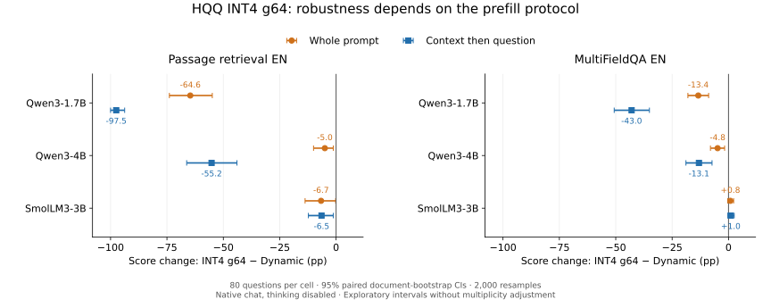

**LongBench protocol_v1: результаты полной серии, 8 ноября 2026 года.**

Получены 36 ячеек × 80 вопросов = **2 880 ответов**: Qwen3-1.7B, Qwen3-4B и
SmolLM3-3B; passage_retrieval_en и multifieldqa_en; Dynamic/g16/g64;
single_prefill и context_then_question. Массив Slurm: **4495433**.

Главный результат: устойчивость HQQ INT4 g64 существенно зависит от модели и
порядка использования cache. У Qwen3-4B падение retrieval_score относительно
Dynamic меняется с −5.00 до −55.21 п.п.; дополнительный эффект split равен
**−50.21 п.п., CI [−61.88; −38.33]**. Поэтому устойчивость большей модели,
наблюдаемая при подаче всего входа сразу, ограничена проверенным протоколом.

Источник — терминальный вывод полного scoring и отдельно предоставленный
`paired_contrasts.csv`. Проверено наличие 36 уникальных агрегированных строк и
согласованность всех 44 точечных контрастов с их средними. Полные JSONL остаются
на кластере; интервалы скопированы из его CSV и не пересчитывались в этом checkout.
Вывод scoring сообщает о пройденных проверках матрицы. Полный `sacct` в снимок не входил.

[Оценки CSV](../reports/protocol_v1_2026-11-08/dataset_scores.csv)
· [Контрасты CSV](../reports/protocol_v1_2026-11-08/paired_contrasts.csv)
· [Происхождение и контрольные суммы](../reports/protocol_v1_2026-11-08/provenance.json).



**Условия и смысл сравнений.** FP16/SDPA, HQQ INT4, axis_key=axis_value=1,
residual_length=128; native chat template с enable_thinking=False. Предел входа
16 384 токена, greedy, предел ответа 32 токена для retrieval и 64 для QA.
Внутри модели оба протокола получают одни и те же полные token IDs. Во втором
протоколе они подаются двумя частями: документ, затем вопрос и assistant suffix.

Retrieval и QA F1 показываем отдельно. Парный percentile bootstrap: 2 000 повторов,
seed 2026, ресэмплирование исходных context/document; 80 документов retrieval и
67 документов QA. Средний score взвешен по вопросам. Все CI номинальные 95%,
без коррекции множественных сравнений. Это два выбранных набора LongBench,
а не общий результат leaderboard; 2 880 ответов не являются независимыми задачами.

**Retrieval EN, официальный retrieval_score, %.**

| Модель | Prefill | Dynamic | g16 | g64 |
|---|---|---:|---:|---:|
| Qwen3-1.7B | весь вход | 97.50 | 95.62 | 32.85 |
| Qwen3-1.7B | документ → вопрос | 97.50 | 96.25 | 0.00 |
| Qwen3-4B | весь вход | 96.25 | 96.25 | 91.25 |
| Qwen3-4B | документ → вопрос | 97.50 | 98.75 | 42.29 |
| SmolLM3-3B | весь вход | 83.44 | 85.31 | 76.77 |
| SmolLM3-3B | документ → вопрос | 84.06 | 86.35 | 77.60 |

Парные изменения g64 относительно собственного Dynamic и взаимодействие с протоколом, п.п.:

| Модель | g64−Dynamic: весь вход | g64−Dynamic: документ → вопрос | Дополнительное изменение split |
|---|---|---|---|
| Qwen3-1.7B | -64.65 [-73.92; -54.90] | -97.50 [-100.00; -93.75] | -32.85 [-42.27; -24.00] |
| Qwen3-4B | -5.00 [-10.00; -1.25] | -55.21 [-66.25; -43.96] | -50.21 [-61.88; -38.33] |
| SmolLM3-3B | -6.67 [-13.75; -0.21] | -6.46 [-12.29; -1.25] | +0.21 [-6.04; +6.67] |

**QA EN, официальный F1, %.**

| Модель | Prefill | Dynamic | g16 | g64 |
|---|---|---:|---:|---:|
| Qwen3-1.7B | весь вход | 45.88 | 45.30 | 32.47 |
| Qwen3-1.7B | документ → вопрос | 45.87 | 45.81 | 2.91 |
| Qwen3-4B | весь вход | 54.28 | 53.93 | 49.44 |
| Qwen3-4B | документ → вопрос | 54.28 | 51.83 | 41.16 |
| SmolLM3-3B | весь вход | 43.19 | 43.48 | 44.03 |
| SmolLM3-3B | документ → вопрос | 43.19 | 41.84 | 44.18 |

Парные изменения g64 относительно собственного Dynamic и взаимодействие с протоколом, п.п.:

| Модель | g64−Dynamic: весь вход | g64−Dynamic: документ → вопрос | Дополнительное изменение split |
|---|---|---|---|
| Qwen3-1.7B | -13.41 [-18.00; -8.82] | -42.96 [-50.69; -35.07] | -29.56 [-36.53; -22.93] |
| Qwen3-4B | -4.84 [-8.00; -1.73] | -13.12 [-18.88; -7.31] | -8.28 [-14.61; -2.56] |
| SmolLM3-3B | +0.83 [-0.38; +2.27] | +0.99 [-0.26; +2.53] | +0.16 [-0.54; +0.95] |

**Что подтверждается на этой выборке.**

1. У Qwen3-1.7B g64 существенно снижает метрики даже при native chat. При split
   официальный retrieval_score равен 0 на всех 80 ответах; QA F1 — 2.91 против
   45.87 у Dynamic. Дополнительные потери split относительно single, уже с учётом
   собственного baseline каждого протокола, равны −32.85 п.п. retrieval и −29.56 п.п. QA.
2. Qwen3-4B устойчивее 1.7B в обеих постановках, но при split сама теряет
   55.21 п.п. retrieval и 13.12 п.п. QA. Размер помогает в пределах этого сравнения,
   однако не гарантирует сохранение качества при другом использовании cache.
3. У SmolLM3-3B наблюдается умеренная потеря retrieval: около 6.5–6.7 п.п.
   Взаимодействие с порядком prefill не выделяется: +0.21 п.п. retrieval,
   CI [−6.04; +6.67], и +0.16 п.п. QA, CI [−0.54; +0.95]. QA g64−Dynamic
   близко к нулю, CI включают ноль. Положительные средние не устанавливают улучшение.
4. Прямые парные различия потерь между моделями уже рассчитаны. Например,
   SmolLM3−Qwen3-1.7B в split: +91.04 п.п. retrieval [84.17; 97.08] и
   +43.95 п.п. QA [35.91; 51.81]. Эти различия не изолируют архитектуру:
   отличаются обучение, размер и tokenizer. Самостоятельный CI сравнения
   SmolLM3 с Qwen3-4B пока отсутствует; соответствующий CPU-анализ подготовлен.

**g16 обычно близок к baseline, но универсальной эквивалентности нет.**
Для Qwen3-4B split QA разница равна −2.45 п.п. [−5.07; −0.55],
для SmolLM3 split QA — −1.35 п.п. [−2.82; −0.07]. Небольшие номинальные
эффекты особенно чувствительны к множественным сравнениям. При g16−Dynamic=0
и CI [0;0] на одной retrieval-выборке устанавливается совпадение её оценок,
а не универсальная эквивалентность моделей. Монотонность качества по group size
также не следует из всех наблюдений: у SmolLM3 QA средний g64 выше g16.

**Формат ответа и деградация генерации.**

| Модель | g64 retrieval: лимит, весь вход | g64 retrieval: лимит, split | g64 QA: лимит, весь вход | g64 QA: лимит, split |
|---|---:|---:|---:|---:|
| Qwen3-1.7B | 57/80 | 76/80 | 3/80 | 67/80 |
| Qwen3-4B | 6/80 | 32/80 | 5/80 | 17/80 |
| SmolLM3-3B | 58/80 | 61/80 | 22/80 | 25/80 |

У Qwen3-1.7B split g64 чаще возникают повторения, мусорные продолжения и
достижение лимита. В QA это 67/80 ответов против 5/80 при single Dynamic.
Для retrieval даже SmolLM3 Dynamic часто достигает лимита: 59/80 в обеих
постановках. Поэтому официальный retrieval_score и правильный первый номер
следует диагностировать отдельно. Первое число — вспомогательная эвристика.
Повторение текста `</think>` в повреждённых ответах не доказывает смену настройки
thinking; нужно исследовать выходные IDs и развитие расхождения.

**Два ограничения причинной интерпретации требуют следующей проверки.**

Во-первых, Dynamic на полной выборке не всегда воспроизводит тот же результат
между single и split. У Qwen3-4B retrieval средний score меняется 96.25→97.50;
у SmolLM3 — 83.44→84.06. У Qwen3-1.7B QA разница около −0.00635 п.п.
Совпадение средних других ячеек также не доказывает совпадение отдельных ответов.
Численное различие FP16/SDPA при другой форме forward — возможное объяснение,
которое пока не установлено. Взаимодействия выше используют свой Dynamic
для каждого протокола, поэтому это уже не простая разность двух quant scores.
Нужно дополнительно посчитать изменения IDs, первых токенов, текста и оценок
по отдельным заданиям.

Во-вторых, split меняет историю квантования: prompt cache первоначально создаётся
по документу, вопрос читает приближённый контекст, а длинный блок вопроса может
позже вызвать переквантизацию residual storage. По агрегатам качества нельзя
разделить эти причины. Сохранённые `quantize_calls_by_layer` показывают события,
но их корреляция с ошибками сама по себе не является причинным доказательством.

**Ближайшее действие — CPU-анализ существующих JSONL.**

```bash
cd ~/kv-cache-longbench-pilot
git pull --ff-only
module load python
conda activate kvcache
python -m src.analyze_protocol_details
```

Он читает полную матрицу и сохраняет отдельные CSV в
`results/protocol_v1/details/full/`: Dynamic drift, первые токены/числа,
счётчики квантования, примеры расхождений и прямые сравнения всех пар моделей.
В stdout выводятся ключевые показатели и недостающий CI SmolLM3−Qwen3-4B.
Повторная генерация не требуется. Скрипт сохраняет официальные оценки;
новые счётчики являются диагностикой. Сами локальные JSONL не публикуются.

**Следующие GPU-эксперименты после этой диагностики.**

1. Контроль повторной квантизации: g64 с residual_length, превышающим максимальную
   фактическую длину query block плюс лимит ответа. Выбрать общий порог по данным,
   зафиксировать его до запуска, сравнить с текущим 128 на тех же token IDs.
   Это проверит роль refresh; при сохранении провала требуется исследовать
   искажение контекста уже при обработке вопроса. Отдельная серия, с новым manifest.
2. Уточнение границы group size: g32 для Qwen3-1.7B и Qwen3-4B, обе задачи,
   оба порядка prefill, те же 80 входов: **640 новых генераций**. При необходимости
   добавить SmolLM3 ещё 320. Текущий protocol_v1 не принимает такую матрицу
   одной заменой CLI-флага; для продолжения нужна отдельная конфигурация/runner.
3. Механистический контроль на заранее выбранных 20–30 вопросах: общий
   teacher-forced префикс, NLL/logit margins, K-only/V-only, затем чувствительные
   блоки слоёв. Разведочные примеры ошибок не использовать как итоговый test set
   для выбора mixed-cache политики.
4. Независимое подтверждение на новых документах/типе QA — после выбора
   проверяемой гипотезы. Это даст переносимость за пределы нынешних 80 вопросов,
   которые уже использовались в предыдущих сериях и в разработке протокола.

Пока получен результат о качестве. Resident KV bytes и сопоставимый throughput
не измерены этой сводкой, поэтому она не устанавливает итоговую эффективность
или Pareto-оптимальность g16/g64. Для отчёта научруку основная формулировка:
**«Чувствительность stock HQQ KV-cache quantization определяется совместно
моделью и способом построения/использования кэша; увеличение модели само по себе
не обеспечивает устойчивость при переносе на другой prefill-протокол».**

График воспроизводится из опубликованного aggregate CSV:

```bash
python tools/plot_protocol_snapshot.py
```

Для него нужен Matplotlib в отдельном analysis-окружении. Исходный scoring
и новые CPU-диагностики не требуют установки Matplotlib на кластере.
