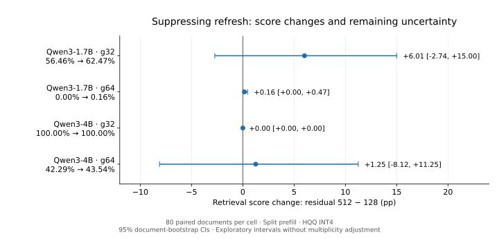

**Полные результаты residual_v1, 11 ноября 2026 года.**

Контроль завершён: **4 ячейки, 320 новых ответов**, по 80 уникальных retrieval
context в каждой ячейке. Во всех слоях повторная квантизация подавлена;
первые токены совпали с тем же cache при residual=128. Условия заданы в
[протоколе](residual_control_2026-11-10.md).

Главный вывод: **устранение refresh не устраняет крупную деградацию g64**.
Буфер 512 сохраняет точные состояния вопроса/ответа дольше, но документ
по-прежнему был квантован после первого prefill. Полученные результаты
опровергают объяснение полного провала одним лишь повторным обновлением cache.
Они ещё не выделяют отдельный эффект ошибок K/V, слоёв или архитектуры.

Источник — присланные stdout scorer и полный paired_contrasts.csv. Здесь
проверены арифметическая согласованность всех 20 контрастов и совпадение
residual128-средних с прежними опубликованными сериями. CI скопированы,
а не пересчитаны из агрегатов. Полные JSONL, sacct и hardware logs не предоставлены.
Заявление о пройденной матрице относится к выводу scorer на кластере.

[Оценки](../reports/residual_v1_2026-11-11/dataset_scores.csv)
· [Контрасты](../reports/residual_v1_2026-11-11/paired_contrasts.csv)
· [Происхождение](../reports/residual_v1_2026-11-11/provenance.json).

**Официальный retrieval_score и эффект residual512−128.**

| Модель | Cache | r128, % | r512, % | Изменение, п.п. | 95% CI |
|---|---|---:|---:|---:|---|
| Qwen3-1.7B | g32 | 56.46 | 62.47 | +6.01 | [−2.74; +15.00] |
| Qwen3-1.7B | g64 | 0.00 | 0.16 | +0.16 | [0.00; +0.47] |
| Qwen3-4B | g32 | 100.00 | 100.00 | 0.00 | [0.00; 0.00] |
| Qwen3-4B | g64 | 42.29 | 43.54 | +1.25 | [−8.13; +11.25] |

1. Qwen3-1.7B g32 показывает возможное частичное восстановление, но CI
   допускает как небольшое ухудшение, так и заметную пользу. Нельзя заявлять
   ни установленное улучшение, ни отсутствие влияния residual.
   Потеря относительно Dynamic остаётся **−35.03 п.п. [−45.42; −25.24]**.
2. Qwen3-1.7B g64 остаётся в режиме почти полного провала: 0.15625%.
   Относительно Dynamic: **−97.34 п.п. [−100.00; −93.44]**.
   Малое положительное изменение с нижней границей CI на нуле не является
   практическим восстановлением качества.
3. Qwen3-4B g32 сохраняет не только оценки, но и **все 80 последовательностей
   output IDs**. Это наблюдаемое совпадение на выбранных вопросах, а не
   универсальная эквивалентность buffer-конфигураций.
4. Qwen3-4B g64 имеет неопределённый небольшой средний эффект; потеря против
   Dynamic по-прежнему **−53.96 п.п. [−64.58; −42.50]**. Восстановление до baseline
   не произошло. Широкий интервал изменения не позволяет объявить эффект buffer нулевым.

CI: парный percentile bootstrap по исходным context, 2 000 повторов,
seed 2026, номинальные 95%, без поправки множественных сравнений.
Повторно используемые baseline-ответы не являются новым независимым повтором.

**Первый номер и поведение генерации.**

| Модель/cache | Первый номер r128→r512 | Совпали output IDs | Лимит r512 | `</think>` r512 |
|---|---|---:|---:|---:|
| 1.7B g32 | 49→52 из 80 | 15/80 | 32/80 | 45/80 |
| 1.7B g64 | 0→1 из 80 | 9/80 | 78/80 | 67/80 |
| 4B g32 | 80→80 из 80 | 80/80 | 0/80 | 0/80 |
| 4B g64 | 36→36 из 80 | 24/80 | 36/80 | 7/80 |

У 1.7B g32 изменение правильности первого номера +3.75 п.п. с CI [−5.00; +12.50].
У 4B g64 одинаковые суммы 36/80 не означают совпадения правильных примеров:
попарные переходы не представлены в сводке. Первое число остаётся вспомогательной
эвристикой, а текст `</think>` не доказывает переключение режима thinking.

При одинаковом первом токене последующие output IDs изменились в 65, 71,
0 и 56 ответах соответственно. Таким образом, buffer влияет на траекторию
генерации, однако множество изменившихся текстов не обязательно даёт рост
официальной метрики. В сравнении 128→512 одновременно меняются момент refresh
и доля точных состояний; чистая ошибка повторного округления не изолирована.

**Следующий этап.**

Основной механизм refresh проверен как отдельный контроль. Теперь ценнее
независимое подтверждение на новых context и другом типе QA, чем очередное
увеличение residual на тех же 80 вопросах. Для этого подготовлен
[аудит расширения](next_stage_2026-11-11.md): он проверяет доступные документы
с учётом опубликованных пилотов и локальных JSONL кластера, без GPU.

Механистическое продолжение остаётся отдельным небольшим направлением:
teacher-forced сравнение логитов при чтении квантованного документа,
K-only/V-only и чувствительных слоёв на заранее выбранных документах.
Результаты текущего quality-контроля не дают вывода о выигрыше resident KV memory
или throughput; большой residual сохраняет больше точных состояний.

Для научрука: **«При устранении повторной квантизации крупный провал HQQ INT4 g64
сохраняется. Чувствительность связана с использованием приближённого cache
в целом; refresh не является единственным объяснением. Для g32 возможен
частичный вклад политики buffer, но он оценён с заметной неопределённостью».**

График воспроизводится командой `python tools/plot_residual_snapshot.py`;
Matplotlib нужен только в отдельном analysis-окружении.
